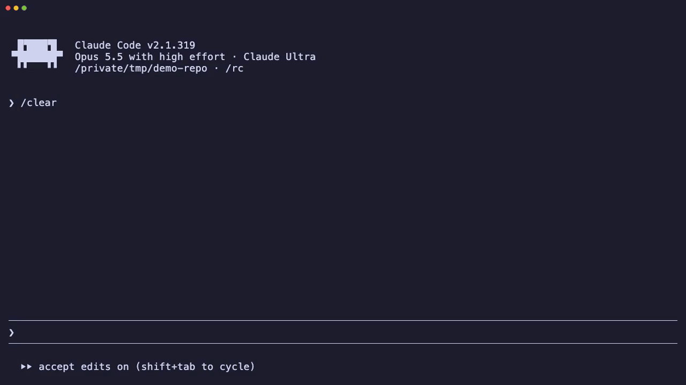
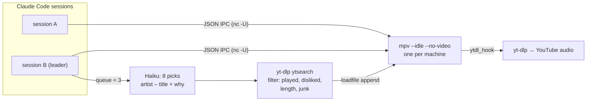

<p align="center">
  
</p>

<p align="center">
  <a href="LICENSE"></a>
  
  
  
</p>

<p align="center">
  <b>Background music for coding that picks itself.</b><br>
  Claude reads your taste and the vibe of the session, finds tracks on YouTube and keeps the queue going.<br>
  No browser tab, no ads, no video — just audio, right in the terminal.
</p>

<p align="center">
  <a href="assets/demo-soundtrack.mp4"></a><br>
  Debugging a bug, then <code>/music soundtrack</code> — Claude picks a track and it fades in.
  <a href="assets/demo-soundtrack.mp4">Watch the video</a>.
</p>

<p align="center">
  <a href="#install">Install</a> ·
  <a href="#use">Use</a> ·
  <a href="#how-it-works">How it works</a> ·
  <a href="#faq">FAQ</a> ·
  <a href="README.ru.md">Русский</a>
</p>

<p align="center">
  
</p>

## Why

You open YouTube for "music to code to", lose ten minutes picking, and an ad breaks your focus halfway through a function. musicflow plays the music in Claude Code itself, and Claude does the picking. It already knows what you're doing: a long debugging session gets calmer music, a fast run of edits gets a beat.

## What you get

| | |
| --- | --- |
| 🎛 **Claude is the DJ** | Haiku reads the station description, your mood, and what you liked, skipped and finished, then picks the next tracks. Every pick shows *why* it was chosen. |
| 📻 **Stations from a sentence** | `/music station like Boards of Canada, but more upbeat` gives an endless stream. `/music play Moby` plays the best match now and keeps going with similar music. |
| 🧠 **Mood that follows your session** | `auto` reads the session: failing commands make it calmer, a burst of edits makes it more energetic, late at night it gets quiet. Or set it in your own words: `rainy evening, no vocals`. |
| 🎬 **Soundtrack this session** | One button (or `/music soundtrack`): Claude reads what you're doing right now (the task, the files, the failing tests, the hour) and scores it like a film scene. *"Stalled race-condition hunt at night"* becomes calm ambient at 70–85 BPM, no vocals. |
| ⌨️ **Media keys** | ⏯ ⏮ ⏭ on your keyboard, headphones and the system's Now Playing control the music, even when the terminal isn't focused. |
| 💬 **Talk to it** | Claude gets a `Music` tool, so "put on something epic" or "stop the music" in the chat just works. |
| ♥ **Learns as you listen** | ♥ and ✕ are strong signals. Skipping early is a weak minus, and listening to the end is a weak plus. Likes collect in a *Liked* playlist. |
| 🪟 **Out of the way** | One dim line under the prompt shows what's playing. `/music` opens the full panel at the side: controls, a play-anything field, mood, the queue with reasons, stations and playlists. |
| 🔁 **Picks up where you left off** | Quit Claude Code and come back later: `/music play` resumes the same track at the same second. |
| 🖥 **One player for every window** | All Claude Code sessions share one `mpv`, so the music never doubles, and a mod reload doesn't interrupt it. |

## Install

At the prompt of a Claude Code terminal session:

```
/plugin install musicflow --marketplace legostin/claude-code-musicflow
```

Answer `y` to add the marketplace, then pick a scope (user is first). Or from a shell:

```sh
claude plugin install musicflow --marketplace legostin/claude-code-musicflow
```

In the desktop app, where `/plugin` doesn't run: click **+** next to the prompt box, then **Plugins**, **Add marketplace** with `legostin/claude-code-musicflow`, then **Add plugin**.

### Setup: `/music setup`

musicflow needs [`mpv`](https://mpv.io) (plays the audio), a **recent** [`yt-dlp`](https://github.com/yt-dlp/yt-dlp) (finds and streams the tracks) and a JS runtime for yt-dlp ([deno](https://deno.com), or node 20+). Run `/music setup` and it checks all of that on your machine, then fixes what it can:

| | What `/music setup install` (or **Install** in the panel) does |
| --- | --- |
| **macOS** | `brew install mpv yt-dlp deno`, `brew upgrade yt-dlp` when it's old. No Homebrew: the official yt-dlp binary and deno go into your home folder; mpv from [brew.sh](https://brew.sh) or mpv.app. |
| **Linux** | The official yt-dlp binary into `~/.local/bin` (distribution packages lag behind YouTube) and deno into `~/.deno`, no sudo. `mpv` comes from your package manager: the panel puts the `sudo apt-get install …` (dnf, pacman, zypper, apk) line into the prompt for you to run. |
| **Windows** | `winget install shinchiro.mpv yt-dlp.yt-dlp DenoLand.Deno` (or scoop). The player link uses a named pipe through PowerShell. |

Or press **Ask Claude to set it up** in the panel: Claude gets the check and installs the rest, asking you before anything that needs sudo.

## Use

Just ask Claude: *"play something like Tycho"*, *"more energetic"*, *"skip this"*, *"what's playing?"*. Or use the command:

| Command | What it does |
| --- | --- |
| `/music` | open the panel |
| `/music play [query]` | play now and keep going with similar music; with no query, resume or start *My wave* |
| `/music station <description>` | an endless station from a description |
| `/music soundtrack` | Claude reads this session and starts a station that scores it |
| `/music next` · `prev` · `like` · `dislike` | skip, back (past 5 s: restart the track), ♥, ✕ (✕ also skips, and the track never comes back) |
| `/music pause` · `resume` · `stop` · `now` | control and status |
| `/music mood <text\|auto>` | set the mood, or follow the session |
| `/music vol <0-100>` | volume |
| `/music playlist save <name>` · `playlist play <name>` | playlists |
| `/music layout below\|above` | now-playing under the prompt (text, default) or in a band above it, with buttons |
| `/music setup [install]` | check mpv, yt-dlp and the rest on this machine; install what is missing |

### Keyboard

- **Media keys** ⏯ ⏮ ⏭ work everywhere, focused or not: on macOS and Windows mpv joins the system's Now Playing by itself. On Linux it needs the `mpv-mpris` package, and `/music setup` offers it.
- **In the panel** (click it, or open it with `/music`): `p` play/pause, `n` next, `b` back, `l` like, `d` dislike, `s` soundtrack this session.
- **The band above the prompt** (`/music layout above`, focus it with `ctrl+x tab`): the same keys, and `m` opens the panel.

Claude Code doesn't let a mod bind global shortcuts of its own, which is why the media keys go through mpv and the system.

## How it works



- **Player.** A detached `mpv` driven over its JSON IPC socket (`~/.claude/musicflow/mpv.sock`). The mod polls it once a second. Because the player lives outside the session, reloads don't cut the music.
- **Recommendations.** When fewer than three tracks are queued, the *leader* session (one per machine, elected through a heartbeat file) asks Haiku for eight picks. Each pick goes through a YouTube search. Hits that were played recently, disliked, too short or too long, or that are reactions, tutorials or cutscenes get dropped. Tracks are queued as soon as they are found. If the model has nothing usable, YouTube's own mix of the current track fills in.
- **Mood.** Each session writes its recent signals (Bash failures, edits) to its own file, and the auto mood reads all of them together with the hour.
- **Memory.** Taste, stations, playlists and mood live in the plugin store. The queue and the position are saved every few seconds for resuming.

## FAQ

<details>
<summary><b>Tracks stopped playing / "found nothing to play"</b></summary>

YouTube changes its player often, and an old `yt-dlp` stops getting audio. Run `/music setup`: it warns when yt-dlp is more than 60 days old and updates it.
</details>

<details>
<summary><b>Does it cost tokens?</b></summary>

A little. Each refill of the queue is one short Haiku request for about eight tracks. Playback itself uses no tokens.
</details>

<details>
<summary><b>What happens with several Claude Code windows open?</b></summary>

They share one player. Pause in any window pauses the music. Only one window (the leader) refills the queue and records what you listened to, so nothing is doubled. The music stops when the last window closes, and `/music play` picks it up from the same spot next time.
</details>

<details>
<summary><b>Windows?</b></summary>

Yes, since 0.4: mpv listens on a named pipe and the mod talks to it through PowerShell; `/music setup` installs mpv, yt-dlp and deno with winget or scoop. It is newer than the macOS and Linux paths: if something is off, please open an issue with the output of `/music setup`.
</details>

<details>
<summary><b>Where is my data?</b></summary>

On your machine: the plugin store of Claude Code and `~/.claude/musicflow/` (socket, session heartbeats, signals, resume point). Nothing is sent anywhere except YouTube searches and the Haiku requests through your own Claude Code session.
</details>

## Develop

```sh
git clone https://github.com/legostin/claude-code-musicflow && cd claude-code-musicflow
claude plugin validate .   # what the engine will load
claude plugin test .       # unit + render tests
claude --plugin-dir .      # run it from the folder
vhs assets/demo.tape       # re-record the demo GIF
```

## License

[MIT](LICENSE) © Legostin Vyacheslav
