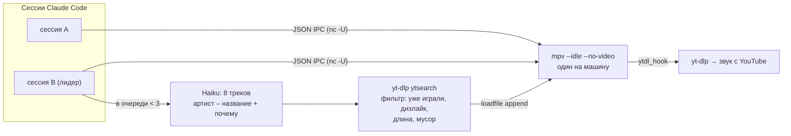

<p align="center">
  
</p>

<p align="center">
  <a href="LICENSE"></a>
  
  
  
</p>

<p align="center">
  <b>Музыка для кодинга, которая подбирается сама.</b><br>
  Claude знает твой вкус и что сейчас происходит в сессии, сам находит треки на YouTube и следит, чтобы очередь не кончалась.<br>
  Без вкладки браузера, без рекламы, без видео: только звук прямо в терминале.
</p>

<p align="center">
  <a href="#установка">Установка</a> ·
  <a href="#как-пользоваться">Как пользоваться</a> ·
  <a href="#как-устроено">Как устроено</a> ·
  <a href="#faq">FAQ</a> ·
  <a href="README.md">English</a>
</p>

<p align="center">
  
</p>

## Зачем

Открываешь YouTube ради «музыки для работы», десять минут выбираешь, а посреди функции фокус сбивает реклама. musicflow играет музыку прямо в Claude Code, а выбирает её Claude. Он и так видит, чем ты занят: при долгом дебаге музыка спокойнее, при быстром потоке правок с битом.

## Что умеет

| | |
| --- | --- |
| 🎛 **Claude — диджей** | Haiku читает описание станции, настроение, что ты лайкал, скипал и дослушивал, и подбирает следующие треки. У каждого видно, *почему* он выбран. |
| 📻 **Станция из одной фразы** | `/music station как Boards of Canada, но бодрее` запускает бесконечный поток. `/music play Moby` сразу включает лучшее совпадение и продолжает похожей музыкой. |
| 🧠 **Настроение под сессию** | `auto` следит за сессией: падающие команды делают музыку спокойнее, поток правок энергичнее, ночью тише. Можно задать и своими словами: `дождливый вечер, без вокала`. |
| 🎬 **Саундтрек сессии** | Одна кнопка (или `/music soundtrack`): Claude читает, чем ты сейчас занят (задачу, файлы, падающие тесты, время суток), и подбирает музыку к этому как композитор к сцене фильма. *«Ночная охота за race condition»* превращается в спокойный ambient на 70–85 BPM без вокала. |
| ⌨️ **Медиаклавиши** | ⏯ ⏮ ⏭ на клавиатуре, наушниках и в системном «Сейчас играет» управляют музыкой, даже когда терминал не в фокусе. |
| 💬 **Можно просто попросить** | У Claude есть инструмент `Music`: «включи что-то эпичное» или «выключи музыку» в чате просто работают. |
| ♥ **Учится по ходу** | ♥ и ✕ — сильные сигналы. Скип в начале трека — слабый минус, дослушал до конца — слабый плюс. Лайки собираются в плейлист *Liked*. |
| 🪟 **Не мешает** | Что играет, видно по одной тусклой строке под полем ввода. `/music` разворачивает панель сбоку: управление, поле запроса, настроение, очередь с причинами выбора, станции и плейлисты. |
| 🔁 **Продолжит с того же места** | Закрыл Claude Code, вернулся позже: `/music play` включит тот же трек с той же секунды. |
| 🖥 **Один плеер на все окна** | Все сессии управляют одним `mpv`, поэтому музыка не дублируется, а перезагрузка мода её не прерывает. |

## Установка

В промпте сессии Claude Code в терминале:

```
/plugin install musicflow --marketplace legostin/claude-code-musicflow
```

Ответь `y`, чтобы добавить маркетплейс, и выбери область установки (user — первая). Или из шелла:

```sh
claude plugin install musicflow --marketplace legostin/claude-code-musicflow
```

В десктоп-приложении, где `/plugin` не работает: нажми **+** рядом с полем ввода, затем **Plugins**, **Add marketplace** с `legostin/claude-code-musicflow`, затем **Add plugin**.

### Настройка: `/music setup`

musicflow нужны [`mpv`](https://mpv.io) (играет звук), **свежий** [`yt-dlp`](https://github.com/yt-dlp/yt-dlp) (находит треки и отдаёт поток) и JS-рантайм для yt-dlp ([deno](https://deno.com) или node 20+). `/music setup` проверяет всё это на твоей машине и исправляет, что может:

| | Что делает `/music setup install` (или **Install** в панели) |
| --- | --- |
| **macOS** | `brew install mpv yt-dlp deno`, `brew upgrade yt-dlp`, если он устарел. Без Homebrew: официальный бинарник yt-dlp и deno ставятся в домашнюю папку, mpv — с [brew.sh](https://brew.sh) или mpv.app. |
| **Linux** | Официальный бинарник yt-dlp в `~/.local/bin` (пакеты дистрибутивов отстают от YouTube) и deno в `~/.deno`, без sudo. `mpv` ставится пакетным менеджером: панель вставит строку `sudo apt-get install …` (dnf, pacman, zypper, apk) в поле ввода, остаётся нажать Enter. |
| **Windows** | `winget install shinchiro.mpv yt-dlp.yt-dlp DenoLand.Deno` (или scoop). Связь с плеером идёт через named pipe и PowerShell. |

Или нажми в панели **Ask Claude to set it up**: Claude получит результат проверки и поставит остальное, спросив тебя перед всем, что требует sudo.

## Как пользоваться

Просто попроси Claude: *«включи что-то как Tycho»*, *«поэнергичнее»*, *«пропусти»*, *«что играет?»*. Или используй команду:

| Команда | Что делает |
| --- | --- |
| `/music` | открыть панель |
| `/music play [запрос]` | включить сейчас и продолжить похожими; без запроса — продолжить или станция *My wave* |
| `/music station <описание>` | бесконечная станция по описанию |
| `/music soundtrack` | Claude читает эту сессию и включает станцию-саундтрек к ней |
| `/music next` · `prev` · `like` · `dislike` | дальше, назад (после 5 с — трек сначала), ♥, ✕ (✕ ещё и пропускает трек, и он больше не попадётся) |
| `/music pause` · `resume` · `stop` · `now` | управление и что сейчас играет |
| `/music mood <текст\|auto>` | настроение или авто |
| `/music vol <0-100>` | громкость |
| `/music playlist save <имя>` · `playlist play <имя>` | плейлисты |
| `/music layout below\|above` | строка под полем ввода (текст, по умолчанию) или полоса над ним с кнопками |
| `/music setup [install]` | проверить mpv, yt-dlp и остальное на этой машине; поставить, чего не хватает |

### Клавиатура

- **Медиаклавиши** ⏯ ⏮ ⏭ работают всегда, даже если терминал не в фокусе: на macOS и Windows mpv сам встаёт в системное «Сейчас играет». На Linux для этого нужен пакет `mpv-mpris`, его предложит `/music setup`.
- **В панели** (кликни по ней или открой через `/music`): `p` пауза/плей, `n` дальше, `b` назад, `l` лайк, `d` дизлайк, `s` саундтрек сессии.
- **Полоса над полем ввода** (`/music layout above`, фокус — `ctrl+x tab`): те же клавиши, плюс `m` открывает панель.

Свои глобальные сочетания клавиш мод в Claude Code завести не может, поэтому медиаклавиши идут через mpv и систему.

## Как устроено



- **Плеер.** Отдельный процесс `mpv`, мод управляет им через JSON IPC-сокет `~/.claude/musicflow/mpv.sock` и опрашивает раз в секунду. Плеер живёт вне сессии, поэтому перезагрузки не обрывают музыку.
- **Рекомендации.** Когда в очереди меньше трёх треков, сессия-*лидер* (одна на машину, выбирается по файлу пульса) просит у Haiku восемь треков. Каждый ищется на YouTube. Отсеиваются треки, которые недавно играли или были дизлайкнуты, слишком короткие или длинные, а также реакции, туториалы и катсцены. Найденный трек сразу ставится в очередь. Если модель не ответила ничем полезным, очередь пополняется YouTube-миксом текущего трека.
- **Настроение.** Каждая сессия пишет свои сигналы (ошибки Bash, правки) в свой файл, а авто-настроение складывает их все с учётом времени суток.
- **Память.** Вкус, станции, плейлисты и настроение хранятся в хранилище плагина. Очередь и позиция сохраняются каждые несколько секунд, чтобы потом продолжить с того же места.

## FAQ

<details>
<summary><b>Треки перестали играть / «found nothing to play»</b></summary>

YouTube часто меняет плеер, и старый `yt-dlp` перестаёт получать звук. Запусти `/music setup`: он предупредит, если yt-dlp старше 60 дней, и обновит его.
</details>

<details>
<summary><b>Тратит ли токены?</b></summary>

Немного. Каждое пополнение очереди — один короткий запрос к Haiku примерно на восемь треков. Само воспроизведение токенов не тратит.
</details>

<details>
<summary><b>Что будет, если открыто несколько окон Claude Code?</b></summary>

Плеер у них общий. Пауза в любом окне ставит на паузу всю музыку. Очередь пополняет и историю пишет только одно окно (лидер), поэтому ничего не дублируется. Музыка выключится, когда закроется последнее окно, а `/music play` в следующий раз продолжит с того же места.
</details>

<details>
<summary><b>Windows?</b></summary>

Да, с версии 0.4: mpv слушает named pipe, а мод общается с ним через PowerShell; `/music setup` ставит mpv, yt-dlp и deno через winget или scoop. Эта часть новее, чем macOS и Linux: если что-то не так, открой issue с выводом `/music setup`.
</details>

<details>
<summary><b>Где мои данные?</b></summary>

У тебя на машине: в хранилище плагина Claude Code и в `~/.claude/musicflow/` (сокет, пульс сессий, сигналы, точка продолжения). Наружу уходят только поисковые запросы на YouTube и запросы к Haiku через твою же сессию Claude Code.
</details>

## Разработка

```sh
git clone https://github.com/legostin/claude-code-musicflow && cd claude-code-musicflow
claude plugin validate .   # что загрузит движок
claude plugin test .       # юнит- и рендер-тесты
claude --plugin-dir .      # запуск из папки
vhs assets/demo.tape       # перезаписать демо-гифку
```

## Лицензия

[MIT](LICENSE) © Legostin Vyacheslav
